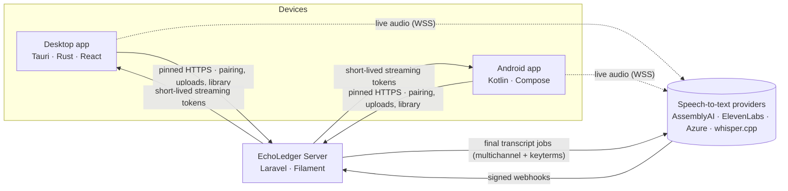

<div align="center">

# EchoLedger

**Private, accuracy-first transcription for calls, meetings and voice notes — running on your own server.**


</div>

---

EchoLedger captures both sides of a conversation — your microphone as **"Me"** and the other party as
**"Client"** — shows live captions while you talk, and produces an accurate, speaker-separated transcript
afterwards. Recordings and transcripts live only on infrastructure you control, encrypted at rest, and every
device sees one unified library.

The platform consists of three applications that share one data model and one REST API:

| Application | Stack | Role |
|---|---|---|
| **Server** (`web/`) | Laravel 13 · Filament 5 · Sanctum | System of record, admin console, REST API, speech-to-text orchestration |
| **Desktop** (`desktop/`) | Tauri 2 · Rust · React 19 · TypeScript | Windows 10/11 and macOS tray app: dual-channel capture, caption overlay, dictation |
| **Android** (`mobile/`) | Kotlin · Jetpack Compose · Glance | WhatsApp call capture, home-screen widget, caption bubble, voice-note import |

## Highlights

- **Two-pass accuracy.** Low-latency live captions stream directly from each device to the speech provider;
  a second, high-accuracy pass transcribes the finished two-channel recording with per-client vocabulary.
- **Speakers separated by design.** Mic and system audio are recorded as separate channels, so "Me" and
  "Client" are labeled without guesswork. Acoustic bleed between channels is detected and removed.
- **Per-client keyterms.** Names, products and jargon configured per client boost recognition in both passes.
- **One library, every device.** Phone recordings appear on the desktop and vice versa, each clearly labeled
  with its source device (Phone · Desktop · Web) and app (WhatsApp, Google Meet, Zoom, voice note …).
- **You decide what is kept.** When a recording ends you choose **Keep** or **Discard**. A discarded recording is
  never uploaded, never transcribed and costs nothing. Only real calls are recorded automatically: apps and
  browser sites are recognised by whether they use the microphone and play audio, with an editable site list.
- **Unobtrusive by default.** A translucent caption overlay that never takes focus, clicks pass through it, it
  hides from screen sharing, and it never interrupts a call with pop-ups. The desktop app builds its windows only
  when needed and idles at about 96 MB.
- **A transcript you can work with.** A player with speaker blocks, word highlighting and bookmarks; inline
  editing with history and "restore original"; full-text search across every recording; export to Word, PDF,
  text, Markdown, SRT, VTT and JSON; and share links with an expiry, an optional password and an access log.
- **Dictation anywhere.** Push-to-talk or toggle on the desktop and a voice keyboard on Android, with a personal
  dictionary, snippets and clean-up. Dictation is never saved as a recording.
- **English, Urdu, Hindi and mixed speech.** Language routing picks the model from the providers' documented
  language lists, and a second engine can be compared against the first.
- **Private by design.** App lock (Windows Hello / Touch ID / PIN on the desktop, biometrics on the phone),
  passkeys and two-step sign-in for the console, an audit log, and a 48-hour undo bin behind every delete.
- **Ready for teams.** Workspaces with owner and member roles, plan limits (minutes, storage, devices), a usage
  dashboard with a monthly budget, and activity notifications.
- **Provider freedom.** AssemblyAI, ElevenLabs Scribe, Azure Speech (MAI-Transcribe) or a self-hosted
  whisper.cpp server, selectable per use case from the admin console. The server side for on-device
  Parakeet transcription is in place for a future release.
- **Runs on shared hosting.** No daemons, Redis or WebSocket server: one cron entry drives the queue,
  webhook reconciliation and retention.

## Architecture



**How a recording flows**

1. A device pairs once with the server using a one-time code (or QR) generated in the admin console and stores
   its scoped token in the OS keychain / Android Keystore.
2. For live captions the device requests a short-lived streaming token; the provider API key never leaves the
   server. Audio streams directly from the device to the provider, one session per channel.
3. When the call ends, the device uploads the two-channel recording in resumable, checksummed chunks.
4. The server verifies and encrypts the file, submits a multichannel transcription job with the client's
   keyterms, receives the signed webhook, stores the normalized transcript and deletes the provider-side copy.
5. Every device picks up the new item on its next library sync; deletions propagate as tombstones.

## Platform capabilities

| Capability | Windows 10 | Windows 11 | macOS 14.4+ | Android 14+ | Web console |
|---|:-:|:-:|:-:|:-:|:-:|
| Microphone ("Me") | ✓ | ✓ | ✓ | ✓ | — |
| Other party ("Client") | ✓ endpoint loopback | ✓ process loopback | ✓ Core Audio tap | ✓ privileged helper | — |
| Live caption overlay | ✓ | ✓ | ✓ | ✓ bubble | — |
| Dictation into any app | ✓ | ✓ | ✓ | ✓ voice keyboard | — |
| Automatic call detection | ✓ | ✓ | ✓ | ✓ WhatsApp | — |
| Keep / Discard after a call | ✓ | ✓ | ✓ | ✓ | — |
| Bookmarks, search, export, share links | ✓ | ✓ | ✓ | ✓ | ✓ |
| App lock | ✓ Hello / PIN | ✓ Hello / PIN | ✓ Touch ID / PIN | ✓ biometrics | passkeys, 2-step |
| Voice-note import | ✓ drag & drop | ✓ drag & drop | ✓ drag & drop | ✓ share sheet | ✓ upload |
| Library, playback, transcript | ✓ | ✓ | ✓ | ✓ | ✓ synced player |

iOS does not allow third-party apps to record VoIP calls, so an iPhone client is out of scope for this release.

## Security and privacy

- **Keys stay on the server.** Provider credentials are encrypted at rest and never sent to devices; devices
  receive only short-lived streaming tokens.
- **Encryption at rest.** Recordings are encrypted with XChaCha20-Poly1305 (libsodium secretstream) under a
  dedicated key on the server, and with Tink streaming AEAD (Android Keystore–wrapped keys) on Android.
- **Hardened transport.** Device apps pin the server's public key (current + backup pins); uploads are
  verified chunk by chunk with SHA-256.
- **Strong administration.** The console offers passkeys and optional TOTP two-factor sign-in with recovery codes
  (recommended); device tokens are scoped by ability and workspace and revocable per device. An audit log records
  sign-ins, deletes, exports, share links and credential changes.
- **Share links.** 256-bit random tokens (only a hash is stored), expiry, optional password, instant revocation and
  an access log.
- **Settings files carry no secrets.** Exports leave out the pairing, tokens and keys; imports can never change a
  credential or turn on a lock.
- **Retention.** Recordings are moved to a 48-hour undo bin after a configurable period (7, 14, 30 days or your own;
  a client can have its own, and a recording can be marked Keep), then erased. Every delete goes through the same
  bin. Provider copies are deleted as soon as a transcript is stored.
- **No telemetry.** None of the applications include analytics or tracking.
- **Consent.** A visible recording indicator is always shown. Call-recording laws vary by jurisdiction; users
  are responsible for obtaining consent where required.

## Repository layout

```
echoledger/
├── web/        Laravel server: API, admin console, STT orchestration, retention
├── desktop/    Tauri desktop app: Rust core (audio, overlay, networking) + React UI
├── mobile/     Android app: capture helper, recording service, widget, caption bubble
├── docs/       User guide, API contract, architecture, providers, requirements, manual QA, research notes
├── PLAN.md          Delivery plan and progress checklist (v1.0)
├── PLAN_V1_1.md     v1.1 plan: every item, its status and its tests
└── CONTRIBUTING.md  Engineering conventions shared by all three apps
```

## Getting started

### Prerequisites

| Component | Requirements |
|---|---|
| Server | PHP 8.4+ (`sodium`, `intl`, `zip`, `pdo_*`), Composer 2, Node.js 22+ (to build the console theme), MySQL 8 / MariaDB 10.4+ or SQLite |
| Desktop | Rust stable (MSVC toolchain on Windows), Node.js 22+, Visual Studio Build Tools (C++) on Windows, Xcode CLT on macOS |
| Android | Android SDK (platform 37), JDK 21 |

On MySQL / MariaDB set `max_allowed_packet` to at least 16 MB: a long call's transcript (up to 20 000 segments) is
saved in one statement. The migrations work with `explicit_defaults_for_timestamp` on or off.

### Server

```bash
cd web
composer install
cp .env.example .env
php artisan key:generate
php artisan echoledger:key            # dedicated recordings encryption key — back it up offline
php artisan migrate --seed
php artisan serve
```

Open `http://localhost:8000/admin`, sign in (passkeys and two-factor sign-in are optional and recommended), then add
provider keys under **API Credentials**. The seeder creates the first super admin from `ADMIN_EMAIL` and
`ADMIN_PASSWORD` in `.env` (12 characters or more; otherwise a random password is printed once). On a production
server use `php artisan echoledger:make-admin` instead and never run the seeders. Production deployment on shared hosting is covered in [`web/DEPLOY.md`](web/DEPLOY.md).

### Desktop

```bash
cd desktop
npm install
npm run tauri dev          # development
npm run tauri build        # signed installers: see desktop/RELEASE.md
```

### Android

```bash
cd mobile
./gradlew assembleDebug    # app/build/outputs/apk/debug/app-debug.apk
```

The Android app is distributed as a signed APK (call recording apps are not eligible for Google Play).
Call capture requires Android 14 or later and a one-time Shizuku or ADB setup; the app guides you through it.

## Speech-to-text providers

| Provider | Live captions | Final transcript | Notes |
|---|:-:|:-:|---|
| AssemblyAI *(default)* | ✓ | ✓ | Universal streaming + multichannel async with keyterms, webhooks |
| ElevenLabs Scribe | ✓ | ✓ | Scribe v2 multichannel, signed webhooks |
| Azure Speech (MAI-Transcribe) | — | ✓ | Fast transcription, phrase lists; use AssemblyAI or ElevenLabs for live captions |
| whisper.cpp (self-hosted) | — | ✓ | Your own GPU/CPU server behind an authenticated proxy |
| Parakeet (on-device) | — | server side ready | Device uploads its own transcript; the on-device engine is not bundled in this release |

Providers are assigned per use case (live captions, dictation, calls, voice notes) in **Settings**. See
[`docs/PROVIDERS.md`](docs/PROVIDERS.md) for credentials, costs and data-retention behaviour.

## Quality

```bash
# Server
cd web && php artisan test && vendor/bin/pint --test && vendor/bin/phpstan analyse
# Desktop
cd desktop && npm run test && npm run build && cd src-tauri && cargo test && cargo clippy --all-targets -- -D warnings
# Android
cd mobile && ./gradlew assembleDebug testDebugUnitTest ktlintCheck lintDebug
# Repository rules and shared design tokens
node --test tools/repo-policy.test.mjs tools/design-tokens.test.mjs
```

Hardware-dependent behaviour (audio capture, overlays, widgets, code signing) is verified with the checklist in
[`docs/MANUAL_QA.md`](docs/MANUAL_QA.md).

## Documentation

| Document | Contents |
|---|---|
| [`docs/USER_GUIDE.md`](docs/USER_GUIDE.md) | How to install, pair and use EchoLedger, in plain language |
| [`docs/API.md`](docs/API.md) | REST API contract shared by all clients |
| [`docs/ARCHITECTURE.md`](docs/ARCHITECTURE.md) | Data model, sync model, audio pipeline, security design |
| [`docs/PROVIDERS.md`](docs/PROVIDERS.md) | Configuring and switching speech-to-text providers |
| [`docs/REQUIREMENTS.md`](docs/REQUIREMENTS.md) | Product requirements and scope |
| [`docs/MANUAL_QA.md`](docs/MANUAL_QA.md) | One ordered checklist for real-device verification (1–2 hours) |
| [`web/DEPLOY.md`](web/DEPLOY.md) | Shared-hosting deployment and cron setup |
| [`desktop/RELEASE.md`](desktop/RELEASE.md) | Windows code signing, macOS notarization, signed updates |
| [`mobile/RELEASE.md`](mobile/RELEASE.md) | APK signing and sideload distribution |

## License

Copyright © 2026 skillLeo. All rights reserved. This is proprietary software; see [`LICENSE`](LICENSE).
Third-party components remain under their respective licenses.
