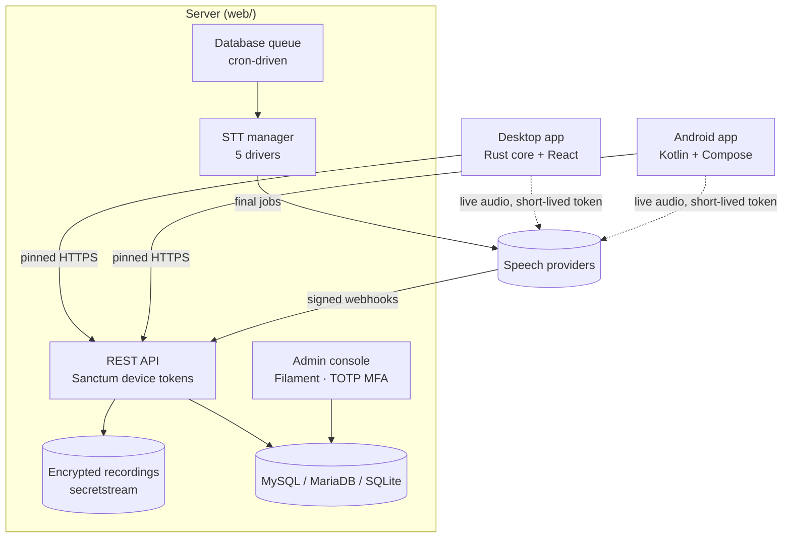
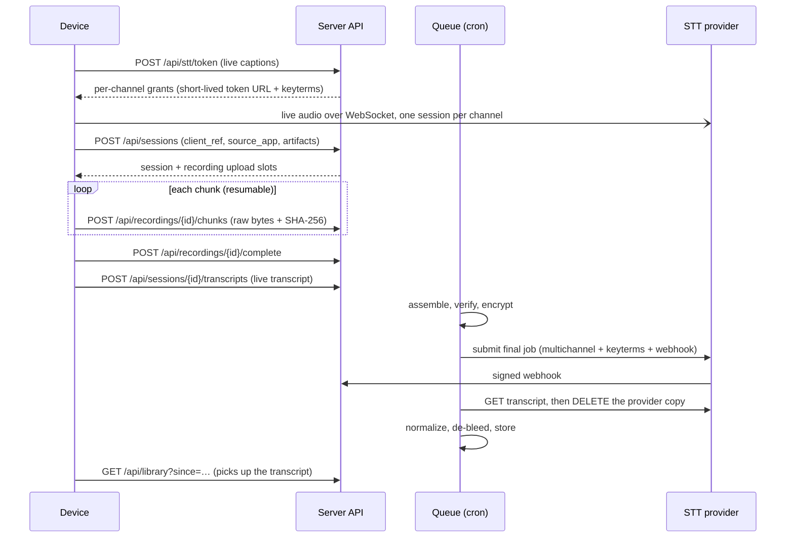
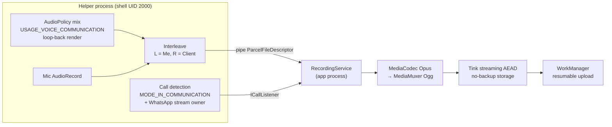

# Architecture

EchoLedger has three applications: a Laravel server, a Tauri desktop app and a native Android app. They share
one data model and one REST API ([`API.md`](API.md)). The server is the system of record. The device apps
capture audio, show live captions and upload finished recordings. Every device reads the same library.



## Shared vocabulary

These values are identical in the database, the API, the Rust and Kotlin enums, and the UI labels.

| Concept | Values | Notes |
|---|---|---|
| `source_device` | `phone` · `desktop` · `web` | Derived on the server from the device platform. Clients never set it. Always shown with an icon and a text label. |
| `source_app` | `whatsapp` · `whatsapp_business` · `google_meet` · `zoom` · `voice_note` · `other` | Set by auto-detection (desktop mic-use classifier, Android call package) or by the user. |
| Channel 1 | **Me** | The local microphone. The left channel of a stereo artifact. |
| Channel 2 | **Client** | The other party: system audio on desktop, far-end VoIP audio on Android. The right channel. |
| Mono | **Speaker** | Voice notes and microphone-only recordings. |

## Data model

All public identifiers are ULIDs. Capture sessions are soft-deleted, and the soft-delete rows act as sync
tombstones.

| Table | Purpose | Key constraints |
|---|---|---|
| `users` | Admin accounts: `is_super_admin`, TOTP secret, recovery codes (both encrypted). | Only super admins can open the console. |
| `devices` | Paired desktop and phone installs: platform, versions, `last_seen_at`. The Sanctum tokenable. | Revoking a device deletes its tokens. |
| `device_pairing_codes` | One-time codes, stored as SHA-256 hashes. | Valid 10 minutes, single use. |
| `clients` | People or companies you talk to: name, colour, language, notes. | Unique per user. |
| `client_keyterms` | Vocabulary hints per client. | Unique `(client_id, term)`, max 100 characters. |
| `capture_sessions` | One conversation: source labels, client, title, timing, status, final provider. | Unique `(device_id, client_ref)` makes session creation idempotent. Soft deletes are the tombstones. |
| `recordings` | 1–3 artifacts per session: `primary`, plus optional `channel_1` and `channel_2`. Holds the upload state (`received_chunks`, checksum) and the encrypted file path. | Unique `(capture_session_id, role)`. |
| `transcripts` | At most one `live` and one `final` transcript per session: provider job ids, normalized segments, status. | Unique `(capture_session_id, kind)`. |
| `settings` | Non-secret JSON settings: retention, provider per use case, provider options, SPKI pins. | — |
| `credentials` | Provider secrets, encrypted with Laravel's `encrypted` cast. | Unique `(provider, key)`. Write-only in the UI. |
| `webhook_events` | Raw provider callbacks for idempotency and audit. | Unique `(provider, idempotency_key)`. |

The status enums:

- **Session:** `recording → uploading → processing → completed | failed`.
- **Upload:** `pending → uploading → assembling → ready | failed`.
- **Transcript:** `pending → submitted → processing → completed | failed`, plus `awaiting_device` for on-device
  engines.

### Normalized transcript shape

Every provider response is normalized to one segment shape:

```json
{ "channel": 2, "speaker": "Client", "start_ms": 12840, "end_ms": 15210, "text": "…", "words": [] }
```

Normalization also removes acoustic bleed. A "Me" segment is dropped when its text closely matches an
overlapping "Client" segment. This happens when the far party's voice leaks from the speaker into the
microphone.

## Pairing and authentication

1. The admin clicks **Devices → Pair a device**. The server creates a random code and stores only its hash. The
   code is shown as text and as a QR payload: `{"v":1,"url":…,"code":…,"pins":[…]}`.
2. The device calls `POST /api/devices/register` with the code. The server creates the `Device` and issues a
   Sanctum token:
   - prefix `eld_`;
   - expires after 365 days by default;
   - explicit abilities: `config:read`, `library:read`, `stt:token`, `sessions:write`, `recordings:upload`.

   The admin password and TOTP code are never typed on a device.
3. Where the token is stored:
   - **Desktop:** the OS keychain (Windows Credential Manager or macOS Keychain). The token never reaches the
     web view: all networking is in Rust, and the Content-Security-Policy allows IPC only.
   - **Android:** sealed with a Tink AEAD keyset wrapped by the Android Keystore, then stored in DataStore.
4. Every authenticated request updates `last_seen_at`. A `401` means the device was revoked: the app stops
   syncing and uploading, keeps queued recordings locally, and asks the user to pair again.

The admin console uses Filament's built-in TOTP multi-factor authentication. It is optional (recommended), includes
recovery codes, and access is limited to super admins.

## Recording lifecycle



**Artifacts.** `GET /api/config` tells each device which artifacts the final provider needs:

- **`primary`:** the stereo recording: lossless FLAC from the desktop, Ogg/Opus from Android. Voice notes keep
  their original format.
- **`channel_1` / `channel_2`:** mono 16 kHz WAV or FLAC. Requested only when the final provider cannot split
  stereo channels or decode Opus (Azure MAI-Transcribe and whisper.cpp).

**Chunked uploads.**

- Each chunk is a raw `application/octet-stream` body, not multipart, so PHP's `upload_max_filesize` does not
  apply.
- Headers: `Upload-Chunk-Index` and `Upload-Chunk-Sha256`.
- The server picks the chunk size: at most 5 MiB, and never more than `post_max_size` allows.
- Chunks can arrive out of order. Re-sending the same chunk is idempotent.
- `GET /api/recordings/{id}` returns the received indexes so a device can resume after a restart or network loss.
- `complete` returns `422` with `missing_chunks` if anything is missing.

**Assembly and encryption.** `AssembleRecordingJob`:

1. concatenates the chunks in order;
2. verifies the declared size and the whole-file SHA-256;
3. encrypts the result with libsodium secretstream (XChaCha20-Poly1305) under the dedicated
   `ECHOLEDGER_RECORDINGS_KEY`;
4. deletes the plaintext parts.

The decryptor requires the final tag, so a truncated file is detected. Once every required artifact of a session
is assembled, the job queues `TranscribeFinalJob`.

**Final transcription.** `TranscribeFinalJob` is idempotent: it skips work when a provider job id already exists.
It branches on the driver's completion mode:

| Mode | Drivers | Behaviour |
|---|---|---|
| `async_webhook` | AssemblyAI, ElevenLabs | Decrypt to a private temp file, upload, submit the job with a webhook URL, delete the temp file in `finally`. |
| `sync` | Azure MAI, whisper.cpp | Transcribe each channel within the job (whisper.cpp in about 10-minute windows with 2 s overlap) and store the result immediately. |
| `device` | Parakeet (on-device) | Mark the transcript `awaiting_device`. The device uploads its own final transcript through `POST /api/sessions/{id}/transcripts`. |

**Webhooks.**

- Every callback is verified before any processing:
  - **AssemblyAI:** a per-transcript HMAC token in the `X-EchoLedger-Webhook-Token` header.
  - **ElevenLabs:** `elevenlabs-signature: t=…,v0=…`, an HMAC-SHA256 over `t.body` with a 30-minute tolerance.
- A bad signature returns `401`.
- Events are de-duplicated through `webhook_events`.
- `ProcessSttWebhookJob` then:
  1. fetches the transcript;
  2. stores it in one transaction;
  3. deletes the provider-side copy, recording `provider_deleted_at`.

If a webhook never arrives, `stt:reconcile` runs every 5 minutes and polls stuck jobs.

## Live captions

Devices never hold provider API keys. `POST /api/stt/token` returns one grant per channel. Each grant contains:

- a ready-to-use WebSocket URL with a short-lived token (AssemblyAI: 60-second token; ElevenLabs: single-use
  token);
- the audio format: 16 kHz s16le mono with a fixed frame size;
- the initial messages, which carry the client's keyterms.

The device streams each channel in its own session and shows the turns:

- **Desktop:** the overlay window.
- **Android:** the caption bubble.

When the session ends, the device uploads the caption turns as the `live` transcript. The library shows them until
the `final` transcript replaces them.

A streaming session is limited by the provider's maximum session length: 3 hours for AssemblyAI, set in the
token request. Captions stop at that limit, but the final transcript always covers the whole recording.

## Library sync

`GET /api/library?since=<server_time>&cursor=…` returns every session changed since the last sync, from every
device.

- Each item carries:
  - its source labels;
  - transcript summary fields: final status, transcript ids, a preview;
  - `updated_at`.
- Deleted sessions come back as tombstones: `{"id": …, "deleted": true, "updated_at": …}`.
- Clients merge by id with last-write-wins on `updated_at`, remove tombstoned items, and store the response's
  `server_time` as the next `since`.

Each client caches the library:

- **Desktop:** in its app data directory.
- **Android:** in an encrypted file in no-backup storage.

Deleting a session from any device makes it disappear everywhere after the next sync. The server deletes the
files and transcripts immediately; the tombstone row is pruned later.

## Audio pipelines

### Desktop (Rust)

**Capture:**

| Platform | Me | Client |
|---|---|---|
| Windows 11 (build ≥ 20348) | WASAPI microphone capture | WASAPI **process loopback** that excludes EchoLedger's own process tree |
| Windows 10 | WASAPI microphone capture | Endpoint loopback of the default render device. EchoLedger stays silent while recording, so nothing of its own is captured. |
| macOS 14.4+ | Default input | Core Audio **process tap** that excludes EchoLedger, combined with the input in an aggregate device |

**Processing:**

- **Alignment.** Both streams are resampled to a shared clock and placed on one timeline: gaps are filled with
  silence and both channels start at the same T0. They are then padded to equal length.
- **Encoding.** The aligned audio is encoded as lossless stereo FLAC (pure Rust, no native codec toolchain);
  providers resample internally, and lossy compression could cost accuracy. The per-channel `mic.wav` and
  `system.wav` files are kept locally until the upload is verified, then deleted.
- **Call detection.** A state machine watches which processes are using the microphone and classifies each one:
  WhatsApp, Zoom, or Google Meet in a browser. It is debounced and ignores EchoLedger's own process.

### Android (Kotlin)

Android 14 and later lets the shell user capture voice-communication output, which is how EchoLedger records the
far side of WhatsApp calls.



**Starting the helper.** The helper is the app's own code, run as the shell user. It starts one of two ways:

- **Shizuku:** as a Shizuku user service. Shizuku performs the one-time Wireless-debugging pairing.
- **ADB:** from a printed `adb shell … app_process …` command. The helper then hands its binder to the app
  through `BinderHandoffProvider`, which accepts callers only with UID 2000, UID 0 or the app's own UID.

**Who opens the microphone.** The helper owns both audio sources. The app process never opens the microphone
in the background; Android forbids starting a microphone foreground service from the background. Instead, an
"armed" special-use foreground service waits for call events and reads interleaved PCM from a pipe.

**After a call.** The user is asked "Save this recording?" through a notification and an in-app list. The
question never appears before or during a call. Calls shorter than 3 seconds are discarded silently.

**Without the helper.** Manual recording falls back to a microphone-type foreground service. It can be started
from the app, a notification action, the home-screen widget or the Quick Settings tile.

**Voice notes.** They are never recorded automatically. They are imported only through the share sheet.

## Security design

| Area | Design |
|---|---|
| Provider keys | Stored only on the server, encrypted at rest (`credentials`). Write-only in the console. Devices receive short-lived, scoped streaming tokens. |
| Transport | Both device apps pin the server's SPKI hashes: the current and a backup pin, delivered at pairing. Desktop uses a custom rustls verifier (WebPKI plus pins); Android uses OkHttp `CertificatePinner`. Provider WebSockets use standard WebPKI. |
| Encryption at rest | Server: secretstream with a dedicated key, kept separate from `APP_KEY` and backed up offline. Android: Tink streaming AEAD with the recording id as associated data, keysets wrapped by the Keystore. Desktop: local files exist only until the upload is verified. |
| API access | Sanctum tokens with per-route abilities. Named rate limiters: `pairing`, `device`, `uploads`, `stt-token`, `webhooks`. The only unauthenticated routes are pairing, signature-checked webhooks and signed audio URLs. |
| Uploads | MIME allowlist, size cap (2 GiB by default), per-chunk and whole-file SHA-256. Files are stored under server-generated ULID paths. |
| Playback | The console streams decrypted audio over a session-authenticated, super-admin-only, owner-scoped route with HTTP Range support. Devices use temporary signed URLs. |
| Retention | `Prunable` models delete recordings, transcripts, webhook payloads and tombstones after the configured number of days (30 by default, 1–365). Files are deleted with their rows. Provider copies are deleted as soon as a transcript is stored. |
| Privacy | No analytics, telemetry or crash-reporting SDKs in any application. A visible indicator is shown whenever capture is active. |

## Background processing on shared hosting

The server needs no daemons, Redis or WebSocket server. A single cron entry runs Laravel's scheduler every
minute:

| Schedule | Task |
|---|---|
| Every minute | `queue:work --stop-when-empty --max-time=55` (database queue, `withoutOverlapping`) |
| Every 5 minutes | `stt:reconcile`, which recovers jobs whose webhook was missed |
| Daily | `model:prune` (retention) and `sanctum:prune-expired` |

See [`web/DEPLOY.md`](../web/DEPLOY.md) for the cron line and PHP limits.
