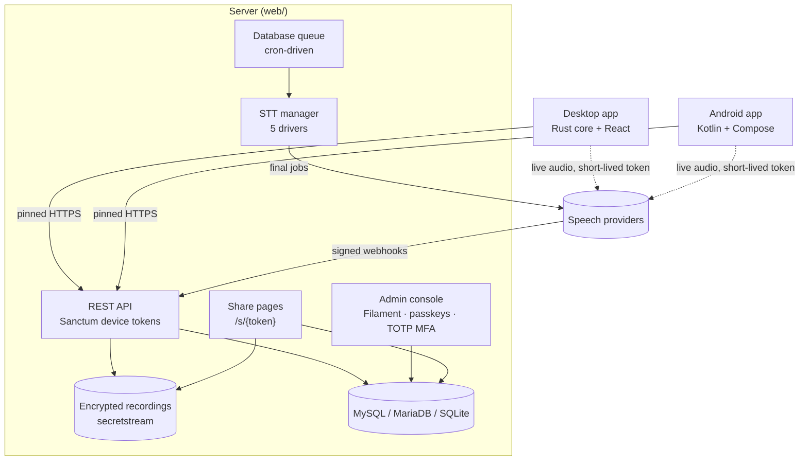
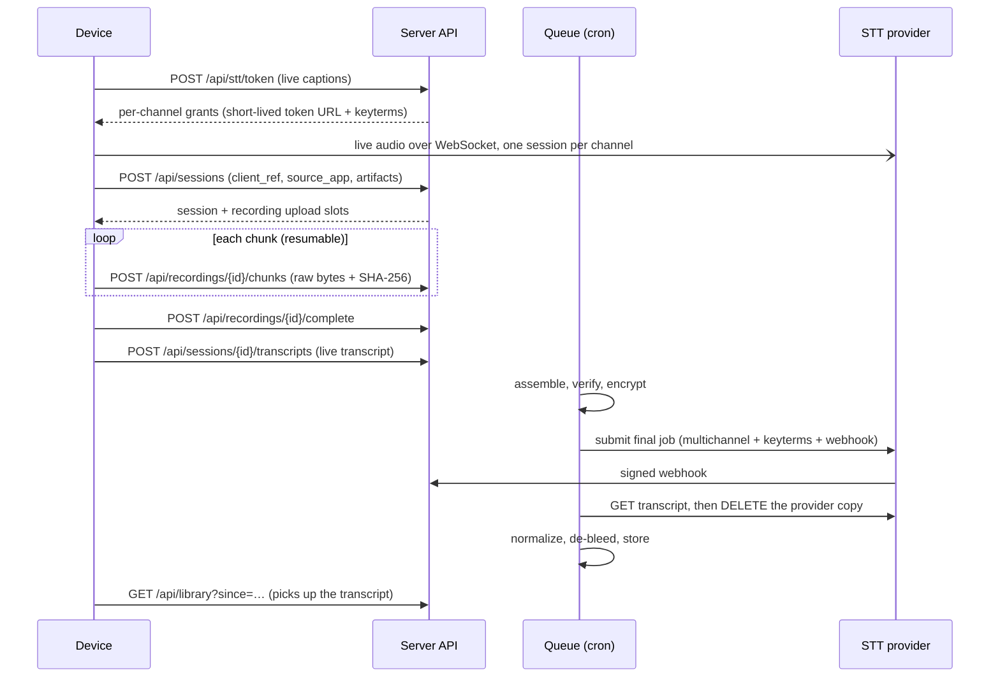
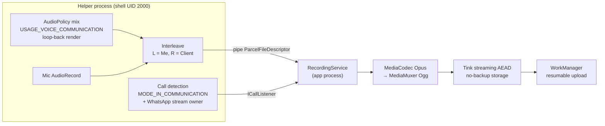

# Architecture

EchoLedger has three applications: a Laravel server, a Tauri desktop app and a native Android app. They share
one data model and one REST API ([`API.md`](API.md)). The server is the system of record. The device apps
capture audio, show live captions and upload finished recordings. Every device reads the same library.



## Shared vocabulary

These values are identical in the database, the API, the Rust and Kotlin enums, and the UI labels.

| Concept | Values | Notes |
|---|---|---|
| `source_device` | `phone` · `desktop` · `web` | Derived on the server from the device platform. Clients never set it. Always shown with an icon and a text label. |
| `source_app` | `whatsapp` · `whatsapp_business` · `whatsapp_web` · `google_meet` · `zoom` · `microsoft_teams` · `voice_note` · `other` | Set by auto-detection (desktop classifier, Android call package) or by the user. Decided once when a recording starts and kept for the whole session. |
| Channel 1 | **Me** | The local microphone. The left channel of a stereo artifact. |
| Channel 2 | **Client** | The other party: system audio on desktop, far-end VoIP audio on Android. The right channel. |
| Mono | **Speaker** | Voice notes and microphone-only recordings. |

## Data model

All public identifiers are ULIDs (users and workspaces use integer ids). Capture sessions are soft-deleted, and the
soft-delete rows act as sync tombstones.

**People and places**

| Table | Purpose | Key constraints |
|---|---|---|
| `users` | Console accounts: `is_super_admin`, `current_workspace_id`, TOTP secret and recovery codes (encrypted). | A user needs a workspace membership or `is_super_admin` to open the console. |
| `plans` | Limits: `monthly_minutes`, `storage_bytes`, `max_devices` (null = no limit). | Default plan "Personal". |
| `workspaces` | The unit that owns data: name, `plan_id`. | Every root table below has a `workspace_id`. |
| `workspace_user` | Membership with a `role` (`owner` or `member`). | Unique `(workspace, user)`; a workspace always keeps one owner. |
| `devices` | Paired desktop and phone installs: platform, versions, `last_seen_at`, `workspace_id`. The Sanctum tokenable. | Revoking a device deletes its tokens. |
| `device_pairing_codes` | One-time codes, stored as SHA-256 hashes, with the workspace they join. | Valid 10 minutes, single use. |
| `passkeys` | WebAuthn credentials for console sign-in. | Unique `credential_id`. |
| `audit_events` | Who did what: sign-ins, deletes, exports, share links, credential changes. Never stores secrets. | Kept 365 days. |
| `notifications` | The activity centre (Laravel database notifications). | Written synchronously. |

**Recordings and transcripts**

| Table | Purpose | Key constraints |
|---|---|---|
| `clients` | People or companies: name, colour, avatar, pinned, language, retention days, speaker names, text replacements. | Unique per user in the database; names are also unique per workspace by validation. |
| `client_keyterms` | Vocabulary hints per client. | Unique `(client_id, term)`, max 100 characters. |
| `capture_sessions` | One conversation: source labels, client, title, timing, `pauses`, status, final provider, `pinned`, `keep_forever`, `speaker_names`, `media_erased_at`. | Unique `(device_id, client_ref)` makes creation idempotent. Soft deletes are the tombstones and the undo bin. |
| `session_markers` | Bookmarks: `at_ms`, tag, note, source (`device` or `web`). | Indexed by session and time. |
| `session_labels` | Free labels on a recording. | Unique `(session, label)`. |
| `recordings` | 1–3 artifacts per session: `primary`, plus optional `channel_1` and `channel_2`. Holds the upload state and the encrypted file path. | Unique `(capture_session_id, role)`. |
| `transcripts` | At most one `live`, one `final` and one `alternate` (second engine) transcript per session: provider job ids, normalized segments, status, language, `error_code`, `edited_at`. | Unique `(capture_session_id, kind)`. FULLTEXT index on the text (MySQL / MariaDB). |
| `transcript_revisions` | Every edit with its author: `original`, `edit`, `replace`, `restore`. | Cascades with the transcript. |
| `share_links` | A link's SHA-256 token hash, password hash, expiry, revocation, audio flag, view count. | Unique `token_hash`; the token itself is never stored. |
| `share_link_views` | Every opening: `viewed`, `wrong_password` or `audio`, with a keyed hash of the IP. | Cascades with the link. |

**Money and housekeeping**

| Table | Purpose | Key constraints |
|---|---|---|
| `usage_ledger` | Minutes and cost: streamed minutes reported by devices (`source = device`) and final minutes written by the server (`source = server`). | Unique `(user_id, report_id)`; no foreign key to transcripts, so the history survives pruning. |
| `settings` | Non-secret JSON settings: retention, provider per use case, provider options, budget and prices, SPKI pins. | — |
| `credentials` | Provider secrets, encrypted with Laravel's `encrypted` cast. | Unique `(provider, key)`. Write-only in the UI. |
| `webhook_events` | Raw provider callbacks for idempotency and audit. | Unique `(provider, idempotency_key)`. |
| `provider_deletions` | Retry queue for erasing provider-side copies. | Unique `(provider, provider_job_id)`. |

Only five root tables carry `workspace_id`: `devices`, `device_pairing_codes`, `clients`, `capture_sessions` and
`usage_ledger`. The rest are reached through one of them and cascade with it. Per-person data (`users`, `passkeys`,
`audit_events`, `notifications`) and server-wide data (`settings`, `credentials`, `webhook_events`) have none.

The status enums:

- **Session:** `recording → uploading → processing → completed | failed`. A recording that the user has not yet
  kept stays on the device and has no session state on the server.
- **Upload:** `pending → uploading → assembling → ready | failed`.
- **Transcript:** `pending → submitted → processing → completed | failed`, plus `awaiting_device` for on-device
  engines. A failed transcript carries an `error_code` (for example `budget_exceeded` or `no_audio`).
### Normalized transcript shape

Every provider response is normalized to one segment shape:

```json
{ "channel": 2, "speaker": "Client", "start_ms": 12840, "end_ms": 15210, "text": "…", "words": [] }
```

Normalization also removes acoustic bleed. A "Me" segment is dropped when its text closely matches an
overlapping "Client" segment. This happens when the far party's voice leaks from the speaker into the
microphone.

## Pairing and authentication

1. The admin clicks **Devices → Pair a device**. The server creates a random code and stores only its hash. The
   code is shown as text and as a QR payload: `{"v":1,"url":…,"code":…,"pins":[…]}`.
2. The device calls `POST /api/devices/register` with the code. The server creates the `Device` and issues a
   Sanctum token:
   - prefix `eld_`;
   - expires after 365 days by default;
   - explicit abilities: `config:read`, `library:read`, `stt:token`, `sessions:write`, `recordings:upload`.

   The admin password and TOTP code are never typed on a device.
3. Where the token is stored:
   - **Desktop:** the OS keychain (Windows Credential Manager or macOS Keychain). The token never reaches the
     web view: all networking is in Rust, and the Content-Security-Policy allows IPC only.
   - **Android:** sealed with a Tink AEAD keyset wrapped by the Android Keystore, then stored in DataStore.
4. Every authenticated request updates `last_seen_at`. A `401` means the device was revoked: the app stops
   syncing and uploading, keeps queued recordings locally, and asks the user to pair again.

The admin console uses Filament's built-in TOTP multi-factor authentication. It is optional (recommended) and
includes recovery codes. Passkeys are an alternative sign-in. A person can open the console as a super admin or as a
member of a workspace; Settings and API credentials stay with super admins. A device token is bound to the
workspace of the person who paired it.

## Recording lifecycle



**Artifacts.** `GET /api/config` tells each device which artifacts the final provider needs:

- **`primary`:** the stereo recording: lossless FLAC from the desktop, Ogg/Opus from Android. Voice notes keep
  their original format.
- **`channel_1` / `channel_2`:** mono 16 kHz WAV or FLAC. Requested only when the final provider cannot split
  stereo channels or decode Opus (Azure MAI-Transcribe and whisper.cpp).

**Chunked uploads.**

- Each chunk is a raw `application/octet-stream` body, not multipart, so PHP's `upload_max_filesize` does not
  apply.
- Headers: `Upload-Chunk-Index` and `Upload-Chunk-Sha256`.
- The server picks the chunk size: at most 5 MiB, and never more than `post_max_size` allows.
- Chunks can arrive out of order. Re-sending the same chunk is idempotent.
- `GET /api/recordings/{id}` returns the received indexes so a device can resume after a restart or network loss.
- `complete` returns `422` with `missing_chunks` if anything is missing.

**Assembly and encryption.** `AssembleRecordingJob`:

1. concatenates the chunks in order;
2. verifies the declared size and the whole-file SHA-256;
3. encrypts the result with libsodium secretstream (XChaCha20-Poly1305) under the dedicated
   `ECHOLEDGER_RECORDINGS_KEY`;
4. deletes the plaintext parts.

The decryptor requires the final tag, so a truncated file is detected. Once every required artifact of a session
is assembled, the job queues `TranscribeFinalJob`.

**Final transcription.** `TranscribeFinalJob` is idempotent: it skips work when a provider job id already exists.
It branches on the driver's completion mode:

| Mode | Drivers | Behaviour |
|---|---|---|
| `async_webhook` | AssemblyAI, ElevenLabs | Decrypt to a private temp file, upload, submit the job with a webhook URL, delete the temp file in `finally`. |
| `sync` | Azure MAI, whisper.cpp | Transcribe each channel within the job (whisper.cpp in about 10-minute windows with 2 s overlap) and store the result immediately. |
| `device` | Parakeet (on-device) | Mark the transcript `awaiting_device`. The device uploads its own final transcript through `POST /api/sessions/{id}/transcripts`. |

**Webhooks.**

- Every callback is verified before any processing:
  - **AssemblyAI:** a per-transcript HMAC token in the `X-EchoLedger-Webhook-Token` header.
  - **ElevenLabs:** `elevenlabs-signature: t=…,v0=…`, an HMAC-SHA256 over `t.body` with a 30-minute tolerance.
- A bad signature returns `401`.
- Events are de-duplicated through `webhook_events`.
- `ProcessSttWebhookJob` then:
  1. fetches the transcript;
  2. stores it in one transaction;
  3. deletes the provider-side copy, recording `provider_deleted_at`.

If a webhook never arrives, `stt:reconcile` runs every 5 minutes and polls stuck jobs.

## Live captions

Devices never hold provider API keys. `POST /api/stt/token` returns one grant per channel. Each grant contains:

- a ready-to-use WebSocket URL with a short-lived token (AssemblyAI: 60-second token; ElevenLabs: single-use
  token);
- the audio format: 16 kHz s16le mono with a fixed frame size;
- the initial messages, which carry the client's keyterms.

The device streams each channel in its own session and shows the turns:

- **Desktop:** the overlay window.
- **Android:** the caption bubble.

When the session ends, the device uploads the caption turns as the `live` transcript. The library shows them until
the `final` transcript replaces them.

A streaming session is limited by the provider's maximum session length: 3 hours for AssemblyAI, set in the
token request. Captions stop at that limit, but the final transcript always covers the whole recording.

## Keep or Discard

A recording does not leave the device until the user decides. When it ends it enters `PendingDecision` (desktop
`pending.rs`, Android `RecordingStore` state `pending_decision`) and stays local.

- **Keep** creates or finishes the server session, uploads the chunks and queues the final transcript. This is the
  first moment that costs money for the final pass.
- **Discard** deletes the local files and any open server session. Nothing is uploaded and no transcript is requested.
- **Undecided** items follow the timeout setting (Keep by default, Discard, or Keep waiting). They are saved on disk
  and listed under "Waiting for your decision" after a restart.
- "Ask before saving" is `Always` (default), `Only automatic calls` or `Never`. With `Never` the recording is kept
  at once.

Live captions are separate. A device opens a streaming socket only when the user started the recording or an
auto-record rule approved it, and closes it on Pause. `POST /api/stt/token` is refused unless the session is open,
owned by the calling device, in the `recording` state and younger than four hours.

## Bookmarks and pauses

A bookmark is a row in `session_markers` (`at_ms`, optional tag and note). Devices send them with the create or
finish call, and later ones through `POST /api/sessions/{id}/markers` (and remove them with `DELETE`); the console
shows them on the player.
A pause is a gap in recorded time stored in `capture_sessions.pauses`: paused time is not captured, streamed or
billed, and the timeline shows it. Bookmarks appear on the player timeline, in the transcript, and as search
filters.

## Transcript tools and exports

- **Editing.** `PATCH /api/transcripts/{id}` changes one line, `…/replace` runs find-and-replace, `…/restore` goes
  back to a revision. Every change writes a `transcript_revisions` row with its author, so "Restore original" always
  works. Speaker names are stored per session (`PUT /api/sessions/{id}/speakers`) and can be remembered per client.
- **Vocabulary.** Global and per-client keyterms are merged within each provider's limits (the client's first).
  Text replacements are applied when a transcript is stored and are reversible through the revisions.
- **Second engine.** `Retranscriber` submits the same audio to another provider as an `alternate` transcript. The
  console shows a word-level diff; "Use the second version" swaps it with the final one and keeps the old as the
  alternate; "Remove" erases the alternate and its provider copy.
- **Exports.** `TranscriptExporter` writes TXT, Markdown, DOCX, SRT, VTT, JSON and a print-ready HTML page (PDF is
  made by printing it, which keeps Urdu and Hindi shaping right). File names are built from the title and date and
  are safe on every file system. Bulk export is one zip with one file per finished transcript.

## Share links

`ShareLinks` makes a 256-bit random token, shows the URL once and stores only its SHA-256. A link expires after
1 hour, 1 day or 7 days, may carry a password (hashed) and the audio, can be revoked, and is limited to 20 active
links per recording. `PublicShareController` serves `/s/{token}`: view-only, `noindex`, no referrer, never cached,
and the same "no longer available" page for an unknown, expired, revoked or binned link. Every access is logged in
`share_link_views` with a keyed hash of the address. Throttles: 120 requests a minute per address, and 10 password
tries a minute per address and link.

## Search

`GET /api/search` and the console Search page look in transcript text and titles, with filters for client, app,
device, date, tag, bookmarks and status. On MySQL and MariaDB it uses a FULLTEXT index; elsewhere (SQLite, tests) it
falls back to `LIKE` with `%` and `_` treated literally. Quoted phrases stay together and every other word must
match. A result carries a highlighted snippet and the millisecond to jump to.

## Retention and the undo bin

`recordings:retention` runs hourly. A recording older than its retention (its client's days, else the global 7, 14,
30 or custom days) goes to the undo bin, unless it is marked Keep. Every delete (device, console or retention)
works the same way:

1. A tombstone is written at once and the provider-side copy is erased.
2. Our encrypted media stays 48 hours. During that time the recording can be restored, but it is never played,
   shared or accepted from a provider callback.
3. Then the audio and transcripts are erased (`media_erased_at`) and, later, `model:prune` drops the row.

A recording deleted while still recording or uploading is erased at once.

## Workspaces, roles and plan limits

Every root table has a `workspace_id`. `BelongsToWorkspace` adds a global scope (`WorkspaceScope`) that filters by
the current workspace, and every request path also filters explicitly, so the scope is a second layer.

- **Who is "current".** A console user: `users.current_workspace_id` (repaired to the first membership). A device
  token: its `devices.workspace_id`. Webhooks, share pages and signed audio URLs: the workspace of the row they
  name. Console commands and jobs work on explicit ids.
- **Roles.** A member records, pairs devices, views, searches, exports, shares, edits and organises everything in
  the workspace, and deletes their own recordings. An owner also deletes any recording, revokes any device, manages
  members and renames the workspace. A super admin (the server operator) also manages Settings, API credentials,
  plan limits and sees every workspace's name and totals, but never another workspace's content.
- **Plan limits.** One service, `PlanLimits`, enforces minutes (`403 budget_exceeded`, the code devices already
  handle), storage (`403 storage_limit_reached`) and devices (`403 device_limit_reached`).
- **Tests.** `WorkspaceIsolationTest` is generated from the route list and the Filament resources: every API route
  and every resource must be isolated or be on a short, justified list of deliberate bypasses.

## Usage and budget

Devices report streamed minutes at the end of a session (`POST /api/usage`, idempotent by `report_id`). The server
writes the final minutes when a transcript completes, from the provider's response times the channels billed. Cost
is the minutes times the price table in Settings (US$ per audio hour per channel). The Usage page reads only
`usage_ledger`. A server cap (minutes or US$, `budget.*`) and the workspace plan limit both apply: the tighter one
decides. At 80 % and 100 % the workspace owners get one notification each per month. Over the limit a token request
is refused, and a final transcription is not sent to a paid provider: it fails with `budget_exceeded` and can be
retried from the console after the limit is raised.

## Sign-in, audit log and activity

- **Console sign-in.** Password with optional TOTP and recovery codes, or a passkey (WebAuthn through
  `web-auth/webauthn-lib`, tied to the host of `APP_URL`). A passkey with user verification skips the TOTP step.
  Sign-in is throttled. The Security page lists web sessions, devices and the audit log, and can sign any of them
  out.
- **Audit log.** `AuditLog` records `login`, `login_failed`, `logout`, `passkey_*`, `password_changed`,
  `device_paired`, `device_revoked`, `device_token_rotated`, `session_deleted`, `transcript_exported`,
  `sessions_exported`, `share_created`, `share_revoked`, `credentials_changed` and `web_session_revoked`. The actor
  is read only from a guard that has already authenticated. Summaries never contain secrets.
- **Activity centre.** Transcript ready, failed uploads, a new device, limit notices and similar events are stored
  as database notifications. The console bell shows them; the desktop polls every minute and the phone every 15
  minutes (WorkManager, no wake locks). Quiet hours hold OS notifications back; a locked app shows only "New
  activity".
## Library sync

`GET /api/library?since=<server_time>&cursor=…` returns every session changed since the last sync, from every
device.

- Each item carries:
  - its source labels;
  - transcript summary fields: final status, transcript ids, a preview;
  - `updated_at`.
- Deleted sessions come back as tombstones: `{"id": …, "deleted": true, "updated_at": …}`.
- Clients merge by id with last-write-wins on `updated_at`, remove tombstoned items, and store the response's
  `server_time` as the next `since`.

Each client caches the library:

- **Desktop:** in its app data directory.
- **Android:** in an encrypted file in no-backup storage.

Deleting a session from any device makes it disappear everywhere after the next sync. The server keeps the encrypted
files and transcripts 48 hours in the undo bin (restorable, never played or shared), then erases them; the tombstone
row is pruned later.

## Audio pipelines

### Desktop (Rust)

**Capture:**

| Platform | Me | Client |
|---|---|---|
| Windows 11 (build ≥ 20348) | WASAPI microphone capture | WASAPI **process loopback** that excludes EchoLedger's own process tree |
| Windows 10 | WASAPI microphone capture | Endpoint loopback of the default render device. EchoLedger stays silent while recording, so nothing of its own is captured. |
| macOS 14.4+ | Default input | Core Audio **process tap** that excludes EchoLedger, combined with the input in an aggregate device |

**Processing:**

- **Alignment.** Both streams are resampled to a shared clock and placed on one timeline: gaps are filled with
  silence and both channels start at the same T0. They are then padded to equal length.
- **Encoding.** The aligned audio is encoded as lossless stereo FLAC (pure Rust, no native codec toolchain);
  providers resample internally, and lossy compression could cost accuracy. The per-channel `mic.wav` and
  `system.wav` files are kept locally until the upload is verified, then deleted.
- **Call detection.** A state machine watches which processes are using the microphone and classifies each one:
  WhatsApp, Zoom, or Google Meet in a browser. It is debounced and ignores EchoLedger's own process.

### Desktop app structure

| Module | Role |
|---|---|
| `audio/` | Capture (WASAPI / Core Audio), timeline alignment, FLAC writer, capture health and level meters. |
| `detect/` | Call detection: audio sessions, process trees, site rules for browsers, the decision explainer. |
| `stt/` | Live caption streams (AssemblyAI, ElevenLabs) with the short-lived grants from the server. |
| `net/` | Pinned HTTP client, uploader (resumable, checksummed), library cache and sync, keychain token store. |
| `pending.rs` | Keep / Discard decisions that survive a restart. |
| `dictation/` | Push-to-talk or toggle, text rules (clean-up, replacements, snippets), insertion at the cursor with clipboard restore. |
| `lock/` | App lock: PIN (PBKDF2-SHA256, 210 000 rounds, stored in `app_lock.json`) and Windows Hello / Touch ID. |
| `overlay/`, `lifecycle.rs`, `material.rs`, `tray.rs` | Windows, tray and window material. |

**Windows are built on demand.** Nothing is created at start-up. The main window is built when it is opened and
destroyed when it is closed (the page, the open recording and the scroll position are kept in the core's memory for
that run). The caption overlay, the recording pill, the review card and the dictation bar are built on first use
and destroyed 30 seconds after they are hidden; a rebuilt one reads its corner, size and content protection from
the settings, and events that arrive while it is still loading are replayed when its page reports ready. The
dictation bar is the one window kept built while a dictation shortcut is bound, because a cold build takes about
one second. Overlays are created with `focused(false)` and `focusable(false)` and are never `show()`n, so a call
window keeps the focus. Idle cost on the build PC: about 96 MB and 0.04 % CPU.

**Settings** are one JSON file; the device token is not in it but in the OS keychain. Exports leave out the pairing
(server address, pins, device id and name) and the consent tick; imports are validated key by key, never change the
pairing or the consent, and never turn on the app lock without a PIN.
### Android (Kotlin)

Android 14 and later lets the shell user capture voice-communication output, which is how EchoLedger records the
far side of WhatsApp calls.



**Starting the helper.** The helper is the app's own code, run as the shell user. It starts one of two ways:

- **Shizuku:** as a Shizuku user service. Shizuku performs the one-time Wireless-debugging pairing.
- **ADB:** from a printed `adb shell … app_process …` command. The helper then hands its binder to the app
  through `BinderHandoffProvider`, which accepts callers only with UID 2000, UID 0 or the app's own UID.

**Who opens the microphone.** The helper owns both audio sources. The app process never opens the microphone
in the background; Android forbids starting a microphone foreground service from the background. Instead, an
"armed" special-use foreground service waits for call events and reads interleaved PCM from a pipe.

**After a call.** The user is asked "Save this recording?" through a notification and an in-app list. The
question never appears before or during a call. Calls shorter than 3 seconds are discarded silently.

**Without the helper.** Manual recording falls back to a microphone-type foreground service. It can be started
from the app, a notification action, the home-screen widget or the Quick Settings tile.

**Voice notes.** They are never recorded automatically. They are imported only through the share sheet.

## Security design

| Area | Design |
|---|---|
| Provider keys | Stored only on the server, encrypted at rest (`credentials`). Write-only in the console. Devices receive short-lived, scoped streaming tokens. |
| Transport | Both device apps pin the server's SPKI hashes: the current and a backup pin, delivered at pairing. Desktop uses a custom rustls verifier (WebPKI plus pins); Android uses OkHttp `CertificatePinner`. Provider WebSockets use standard WebPKI. |
| Encryption at rest | Server: secretstream with a dedicated key, kept separate from `APP_KEY` and backed up offline. Android: Tink streaming AEAD with the recording id as associated data, keysets wrapped by the Keystore. Desktop: local files exist only until the upload is verified. |
| API access | Sanctum tokens with per-route abilities, and every query scoped to the token's workspace. Named rate limiters: `pairing`, `device`, `uploads`, `stt-token`, `search`, `share`, `share-password`, `passkey`, `webhooks`. The only routes without a device token are pairing, signature-checked webhooks, signed audio URLs and the share pages, whose 256-bit token is the key. |
| Uploads | MIME allowlist, size cap (2 GiB by default), per-chunk and whole-file SHA-256. Files are stored under server-generated ULID paths. |
| Playback | The console streams decrypted audio over a session-authenticated route for workspace members, scoped to the current workspace, with HTTP Range support. Devices use temporary signed URLs. |
| Retention | Hourly `recordings:retention`: recordings past their retention (the client's own, else 7 / 14 / 30 / custom days) go to the 48-hour undo bin unless kept; the bin then erases audio and transcripts. Provider copies are deleted as soon as a transcript is stored or the recording is deleted. `Prunable` models remove webhook payloads and old tombstones. |
| Share links | 256-bit random token, only its SHA-256 stored; expiry, optional password, revocation and the audio switch re-checked on every request; every access logged; throttled; `noindex`, no referrer, never cached. |
| Sign-in and audit | Password, optional TOTP with recovery codes, or a passkey. Sign-in, deletes, exports, share links and credential changes are written to `audit_events` (no secrets). Web sessions and devices can be signed out from the Security page. |
| App lock | Desktop: Windows Hello / Touch ID or a PIN (PBKDF2-SHA256, 210 000 rounds, escalating waits); locking hides the app but recording carries on. Android: biometric or device credential, re-lock on leaving the app, `FLAG_SECURE` for Recents and screenshots. |
| Settings files | Exports contain no secrets, pairing, token, lock or consent. Imports are checked key by key and can never change a credential, the pairing, the consent or turn on a lock without a PIN. The console import never touches API credentials. |
| Dependencies | `composer audit`, `npm audit --omit=dev` and `cargo audit` are checked each release (see `docs/HANDOFF.md`). |
| Privacy | No analytics, telemetry or crash-reporting SDKs in any application. A visible indicator is shown whenever capture is active. |

## Background processing on shared hosting

The server needs no daemons, Redis or WebSocket server. A single cron entry runs Laravel's scheduler every
minute:

| Schedule | Task |
|---|---|
| Every minute | `queue:work --stop-when-empty --max-time=55` (database queue, `withoutOverlapping`) |
| Every 5 minutes | `stt:reconcile` (recovers jobs whose webhook was missed) and `recordings:recover` (finishes recordings left half-assembled) |
| Every 15 minutes | `sessions:sweep-open` (closes sessions that were opened and never finished) |
| Hourly | `recordings:retention` (retention and the undo bin) |
| Daily | `model:prune` and `sanctum:prune-expired` |

See [`web/DEPLOY.md`](../web/DEPLOY.md) for the cron line and PHP limits.
