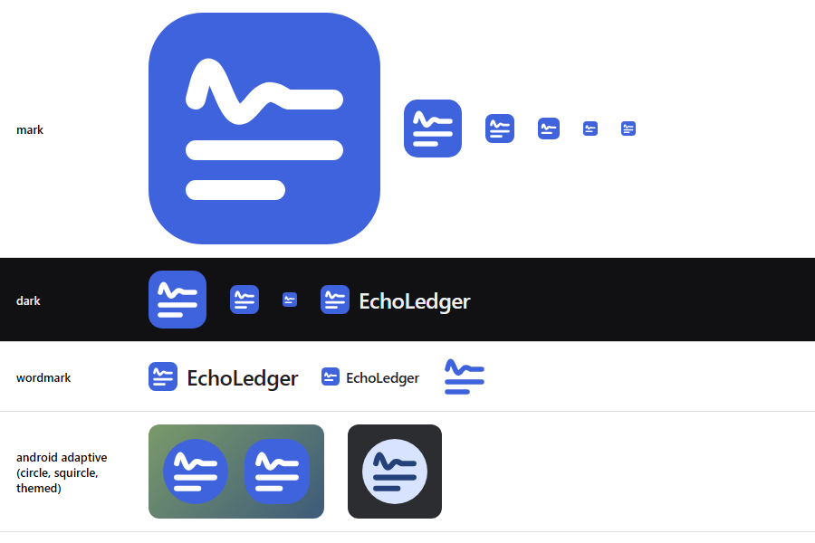

# EchoLedger brand

## The mark

A voice's wave that dies down like an echo and settles into the first written line, above two more lines of the
ledger: what EchoLedger does, in one picture. White strokes on a brand-indigo tile with rounded corners.

| File | Use |
|---|---|
| [mark.svg](mark.svg) | The mark, 24 px and larger: app icons, the console, the site, documents. |
| [mark-small.svg](mark-small.svg) | 16 to 24 px (favicons, tabs, small lists): one line fewer and bolder strokes, so it stays clear. |
| [mark-strokes.svg](mark-strokes.svg) | The strokes alone in brand indigo, for a plain light background (no tile). |

The strokes are drawn on a 64-unit grid: stroke width 5.5 (6.5 in the small mark), round caps and joins, the tile's
corner radius 15. Android draws the same paths in `ic_launcher_foreground.xml` (scaled 1.15 into the adaptive
icon's safe zone) and `ic_mark.xml`.

## Colour

| Role | Light | Dark |
|---|---|---|
| Tile (brand) | `#3E63DD` | `#3E63DD` |
| Strokes on the tile | `#FFFFFF` | `#FFFFFF` |
| Wordmark text | `#1C2024` | `#EDEEF0` |
| Strokes without a tile | `#3E63DD` | `#9EB1FF` |

The same values as the apps' design system (docs/DESIGN_SYSTEM.md, Radix slate and indigo).

## Wordmark

The mark, then "EchoLedger" in Inter SemiBold (600) with tight tracking (-0.4 px at 24 px), the text about 0.75 of
the mark's height and the gap about 0.3 of it. "Echo" and "Ledger" are one word with two capitals.

## Space and size

- Keep clear space of a quarter of the mark's width on every side.
- Smallest size: 16 px (use mark-small.svg below 24 px).

## App icons

- **Android:** an adaptive icon: the strokes as the foreground, brand indigo as the background, the same strokes as
  the themed (monochrome) icon. The splash screen shows the same foreground on brand indigo.
- **Windows and Mac:** generated from a 1024 px render of mark.svg with `npx tauri icon` in `desktop/`.
- **Web:** `favicon.svg` (mark-small.svg) with `favicon.ico` as the fallback.

## Please don't

- Recolour the wave or the lines separately, or add gradients, shadows or outlines.
- Stretch, rotate or crop the mark, or change its corner radius.
- Put the strokes without a tile on a busy or mid-tone background.
- Replace the wordmark's font or split the name into two words.
