# Desktop v2 bug bash, Day 5 (2026-11-17)

Every v2 screen on the desktop at 100, 130 and 200 % text, light and dark, English and Urdu, at 1280 × 800 and at the
720 px compact width: 288 pages. Text size is the window at 1/scale of its size with that device scale, as when the
system text grows. Run again with `node src/v2/gallery/bugbash.mjs --out=DIR` from `desktop/`.

**Screens:** the Gate 3 sample screens in the gallery (Library, recording page, Settings, Library's error state;
English and Urdu) and the Live Assist card; the app's own v2 screens in fixture mode with every v2 flag on (Library,
a recording, Trash, Home, Live, the Live Assist prep, Settings, a Settings page, Setup & health, the pill and the
after-call card; English only, as the app's language).

**How:** each page was photographed and checked in the DOM for:

- the page scrolling sideways;
- text cut without an ellipsis;
- something past the window's edge;
- controls on top of each other.

I then looked at the stress cases myself (200 % at 720 px in both languages, and Urdu at every size). The rail's
visually hidden names below the compact width are by design and are not counted.

**Template look:** `desktop/src/v2/templateLook.test.ts` scans every v2 source for gradients, purple, indigo or violet,
emoji and coloured start borders: **0 findings**. The tokens-only check (`tokensOnly.test.ts`) stays at 0 as well.

## Findings

| Id | Sev | Where | What | Status |
|---|---|---|---|---|
| D-138 | S2 | Toast (Library, any screen with one) | At 200 % in 720 px the toast was half the window wide: one word per line, covering the filters | Fixed in 5c0b26fe |
| D-139 | S2 | Live Assist card | At 200 % in a narrow card the top bar didn't wrap; Hide the card was out of reach | Fixed in 5c0b26fe |
| D-140 | S4 | Empty and error states (Urdu) | The sentence's last word alone on a line | Fixed in 5c0b26fe |
| D-141 | S3 | Pill and after-call card | At 200 % they need about twice their fixed window sizes; the windows are the core's | Logged (core) |
| D-142 | S3 | Library rows | At 200 % in 720 px a title shows about 12 characters | Logged |
| D-143 | S4 | Recording meta line (Urdu) | Middle-dot separators can land at a line's start or end when it wraps | Logged |
| D-144 | S4 | Live | In 720 px with the sidebar open, second lines are cut with an ellipsis | Logged |

No S0 or S1. After the fixes the automated check finds nothing on any of the 288 pages except D-141's windows in the
screenshot canvas, which only the core can size.

## Screenshots

Fixed:

- D-138, the toast at 200 % in 720 px, Urdu: 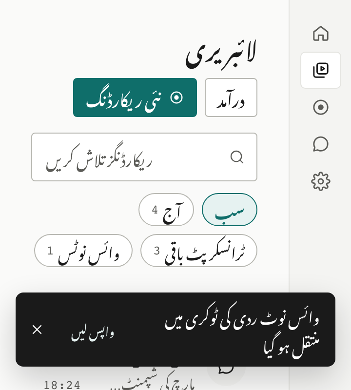
- D-139, the assist card's bar wrapping at 200 %: 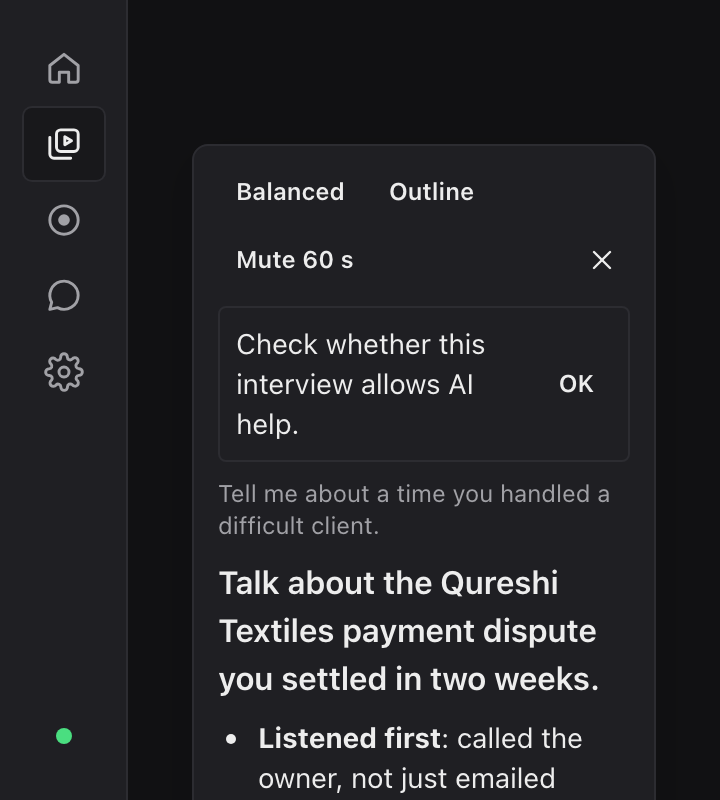
- D-140, the Urdu error sentence: 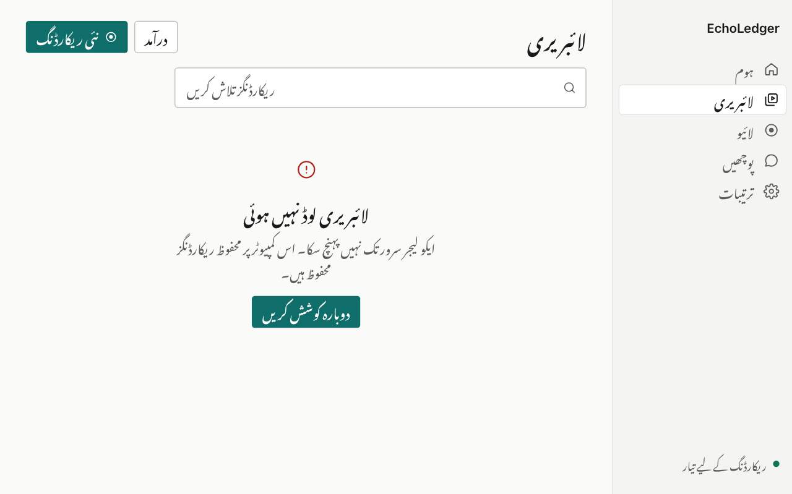

Logged:

- D-141, pill and after-call card at 200 %: 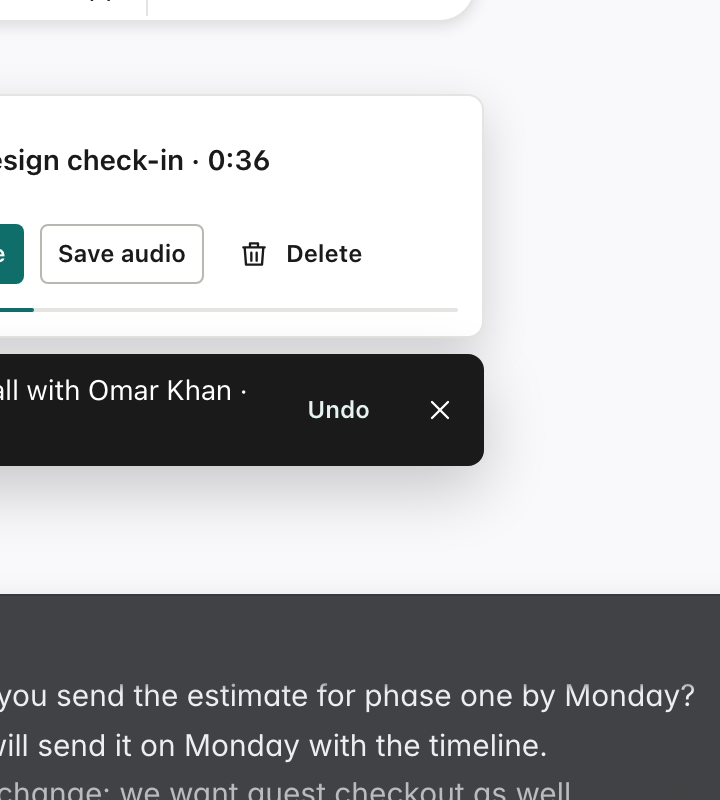
- D-142, Library rows at 200 % in 720 px: 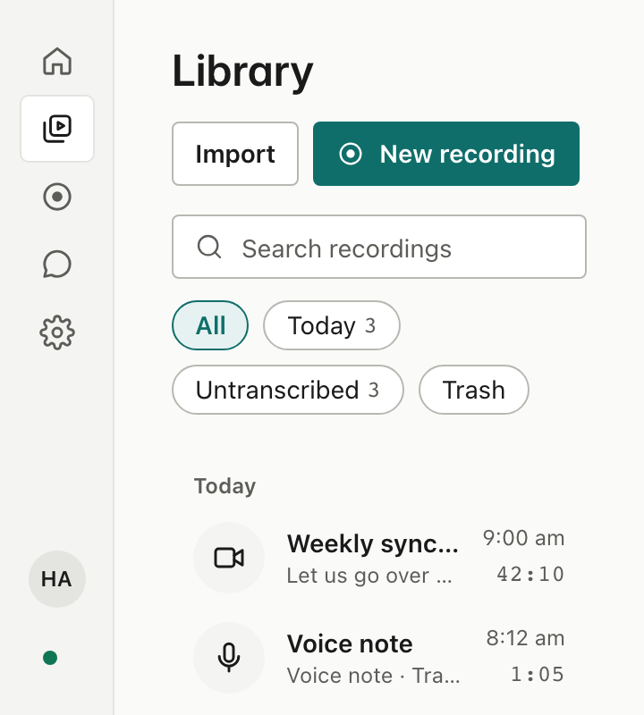
- D-143, Urdu meta line: 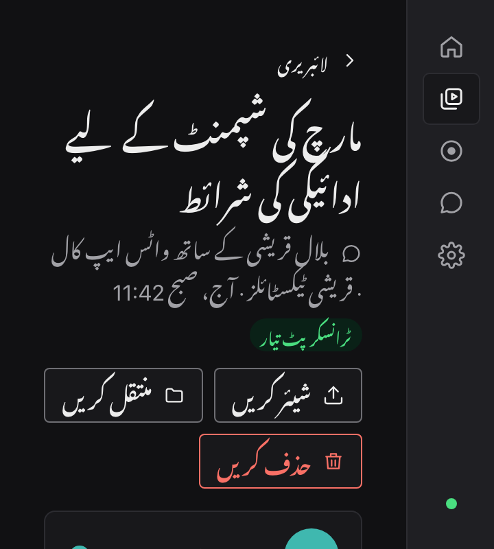
- D-144, Live at 720 px: 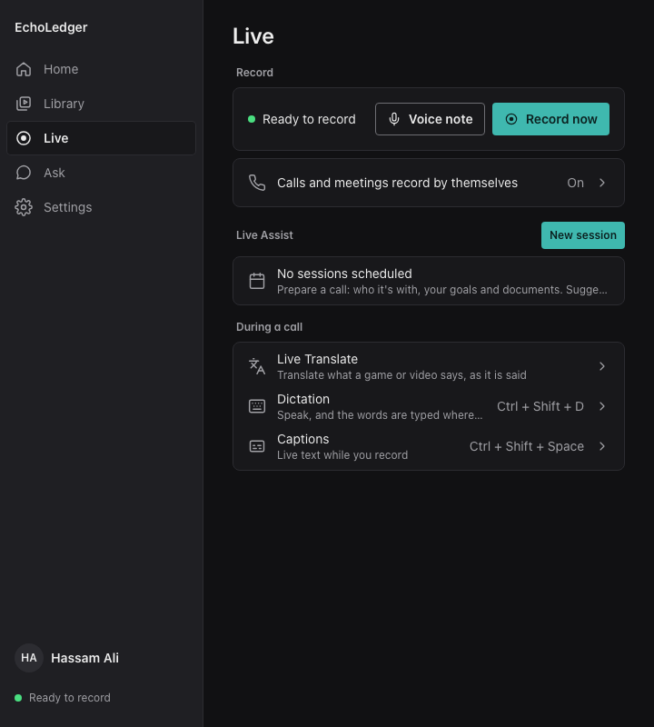

Clean, for reference:

- Home at 130 % in 720 px: 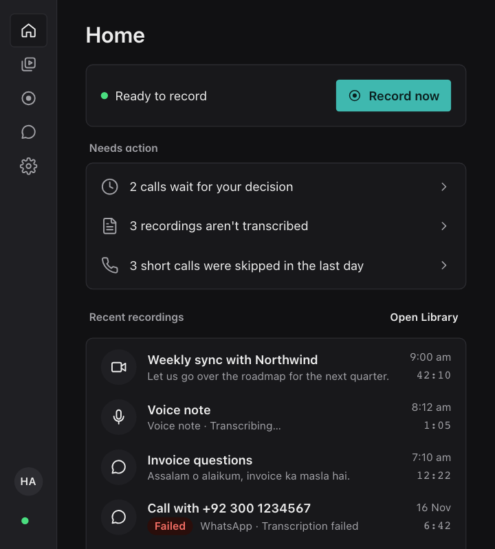
- Settings at 200 %: 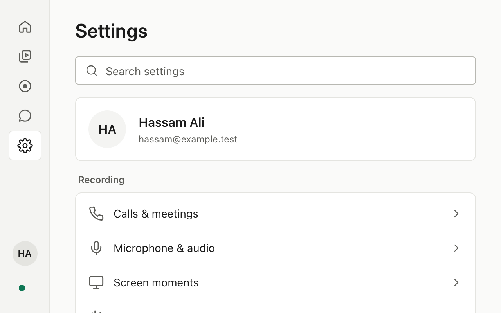
- Setup & health: 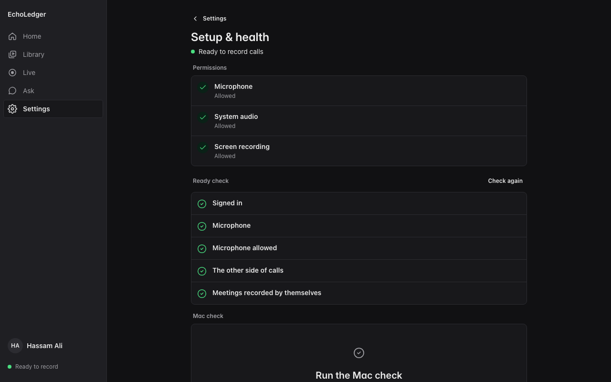
- The Live Assist prep at 130 % in 720 px: 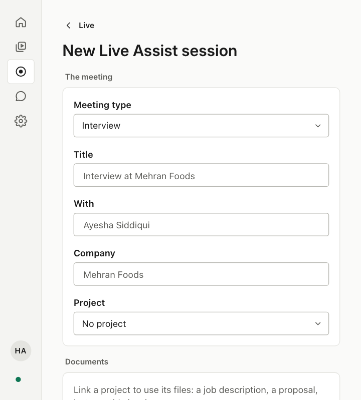
