# Phone v2 bug bash, Day 5 (2026-11-17)

Every v2 screen on the phone at 100, 130 and 200 % text, light and dark, English and Urdu, at the S25's size
(411 × 891 dp): 12 screens × 12 variants = 144 screens, plus the end of each screen at 200 %. Text size is the
system's font scale (Android 14 scales text non-linearly from 130 %). The test is `LargeTextTest`. To get the
pictures and a contact sheet per screen, run it from `mobile/` with an `app/build/bugbash` folder present:

```
mkdir -p app/build/bugbash && bash ./gradlew :app:testFullDebugUnitTest --tests 'com.echoledger.mobile.ui.v2.LargeTextTest'
```

**Screens:**

- Home, and Home while recording.
- Library with the bottom bar.
- A recording and Trash.
- Settings and Settings › Appearance.
- Setup & health.
- The Live tab and the Live Assist card.
- Ask with an answer.
- The recording pill, its menu and the after-call card.

**How:** on every run the test fails if a control is less than 48 dp to touch at 200 % (it uses the control's own
size or its touch area, so a 32 dp chip that takes touches over 48 dp passes). I then looked at every contact sheet
myself, light and dark, for:

- text cut or broken mid-word;
- controls squeezed or out of sight;
- the wrong direction or face in Urdu;
- colours that don't hold in dark.

**Template look:** the v2 phone code has 0 findings against the rules in `../DESIGN_SYSTEM.md`:

- no gradients, purple, indigo or violet, emoji, or coloured start borders;
- no exclamation marks or placeholder copy in the v2 words;
- no looping animation except the recording dot;
- shadows only on floating layers (the card, pill, toast and dialogs);
- radii 4/8/16 plus full.

The tokens-only check (`TokensOnlyTest`) stays at 0.

## Findings

| Id | Sev | Where | What | Status |
|---|---|---|---|---|
| P-079 | S2 | After-call card | At 200 %, Save audio and Delete squeezed Transcribe into a sliver with its letters stacked, in English and Urdu | Fixed in a31dc027 |
| P-080 | S2 | Live Assist card | The buttons scrolled sideways, so More formal and Urdu were out of sight; at 200 % only two showed | Fixed in 5812e0a7 |
| P-081 | S2 | Settings › Appearance | At 200 %, "System" broke mid-word in the theme picker | Fixed in a31dc027 |
| P-082 | S2 | Ask, Library rows, pickers (Urdu) | English content took the Urdu font's Latin letters and a mirrored full stop (".Payment in 45 days as usual") | Fixed in a31dc027 |
| P-083 | S3 | Avatars | At 200 %, the initials grew out of their circle | Fixed in a31dc027 |
| P-084 | S3 | Ask sources (Urdu) | A source's moment was in the Urdu face, not the clock face | Fixed in a31dc027 |
| P-085 | S3 | Library rows | At 200 %, a title shows about 10 to 12 characters | Logged |
| P-086 | S3 | Settings profile card | At 200 %, Upgrade squeezes the usage lines to a few words each (Urdu worst) | Logged |
| P-087 | S3 | Live Assist card | At 200 %, the three-line limit hid most of a suggestion behind an ellipsis | Fixed: from 150 % up to six lines show and the text scrolls beyond |
| P-088 | S4 | Live tab (Urdu) | At 200 %, the row explanations end with one word alone on a line | Logged |
| P-089 | S3 | Ask | The view model's ask() gives no failure back, and "Request failed (502)" is not words for a person | Logged (core) |

No S0 or S1. All S2s are fixed. After the fixes, `LargeTextTest` passes on all 12 screens (no control under 48 dp at
200 %). The Gate 3 and component screenshots were recorded again where the fixes changed them.

## Screenshots

Fixed:

- P-079, the after-call card at 200 % in Urdu, buttons wrapping (the pill and its menu above): 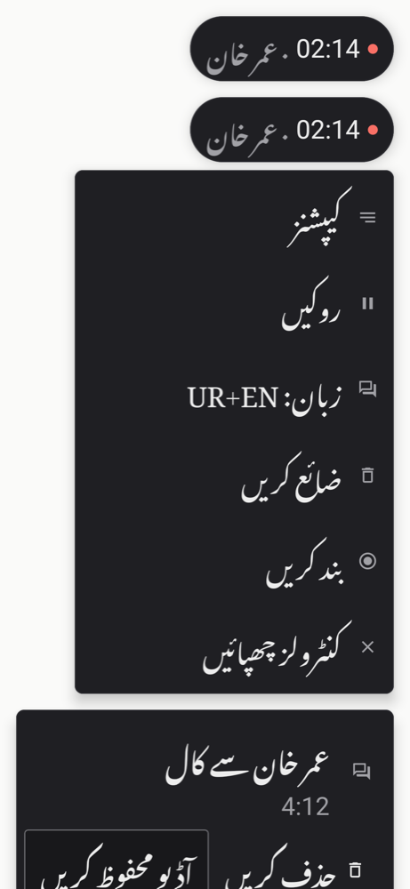
- P-079 in English: 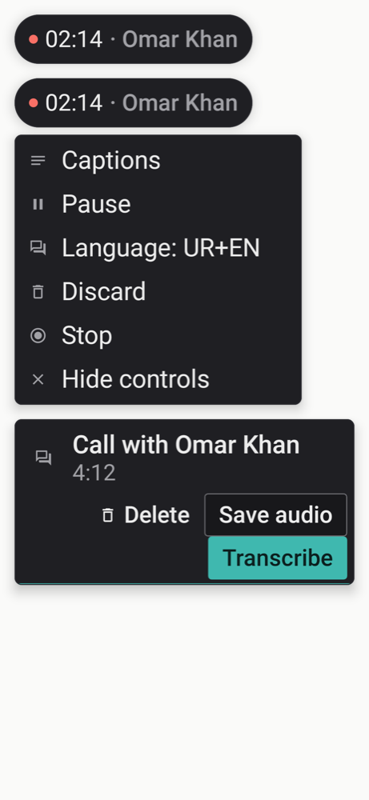
- P-080, the Live Assist card's buttons at 200 %: 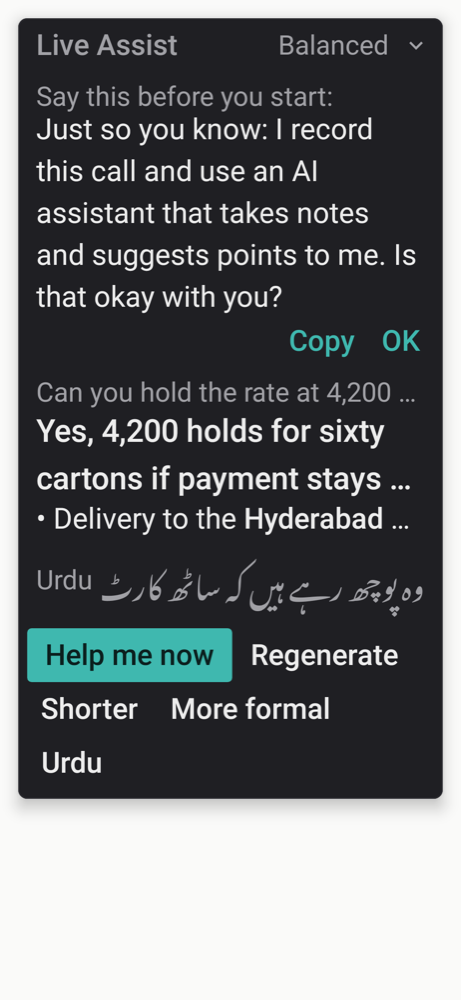
- P-080 in Urdu at 130 %: 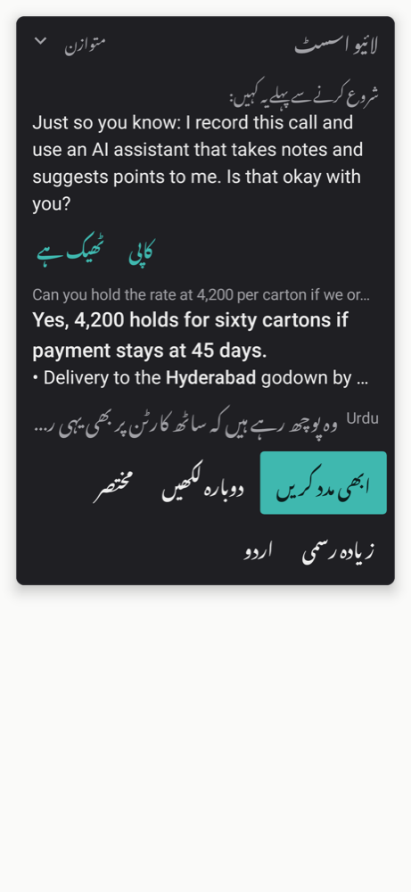
- P-081, the theme picker at 200 %: 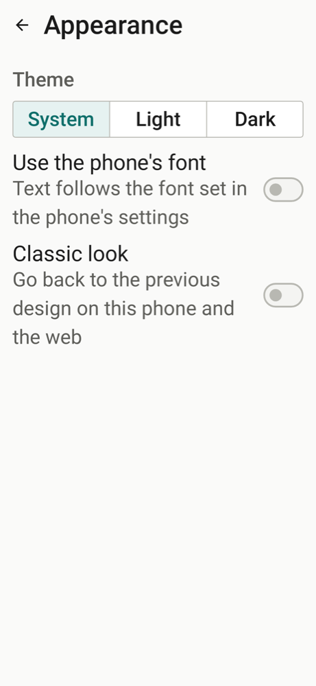
- P-082 and P-084, Ask in Urdu with an English answer, sources and project: 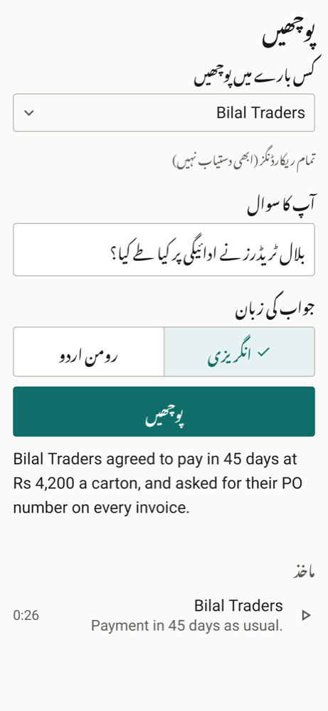
- P-083, the avatar at 200 % in Urdu: 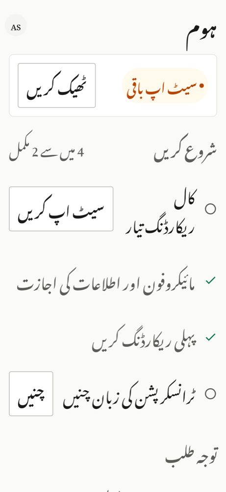
- P-087, the Live Assist card at 200 %: six lines, then the text scrolls: 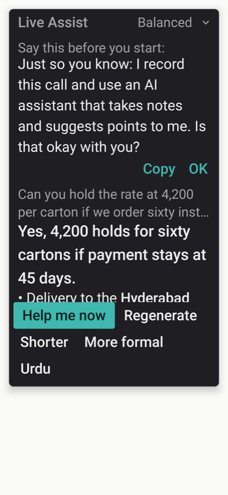

Logged:

- P-085, Library at 200 %: 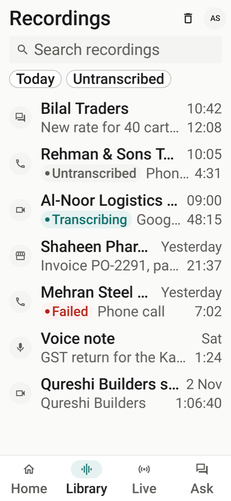
- P-086, the profile card at 200 % in Urdu: 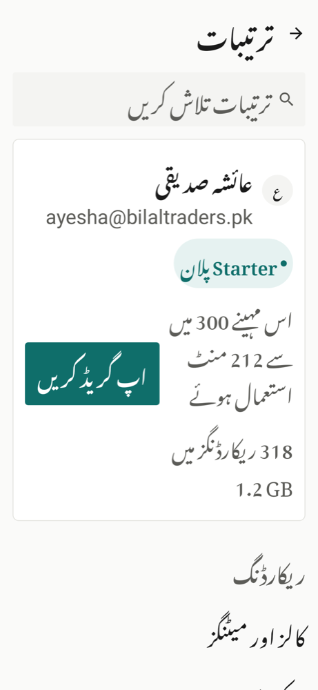
- P-088, the Live tab at 200 % in Urdu: 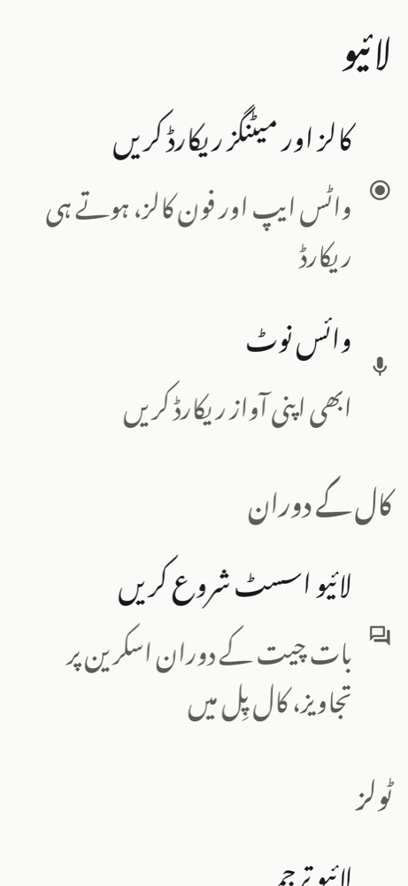

Clean, for reference:

- Home at 130 %, dark: 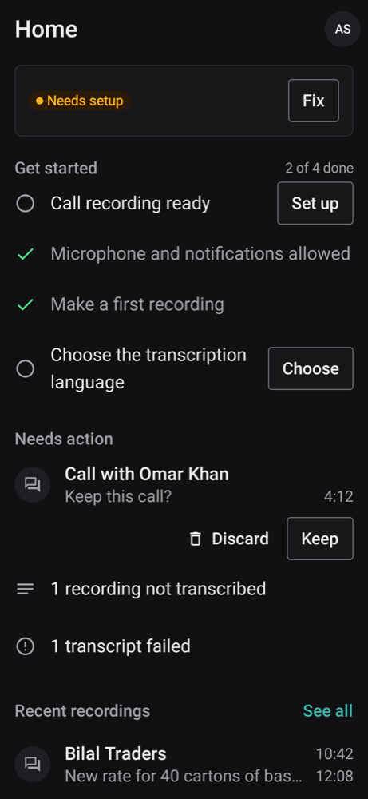
- A recording at 200 % in Urdu, dark: 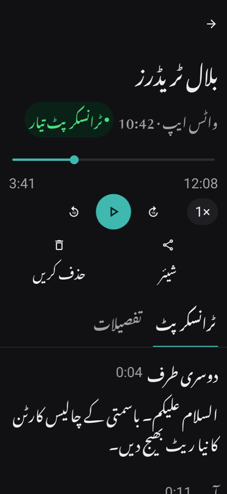
- Setup & health at 130 %: 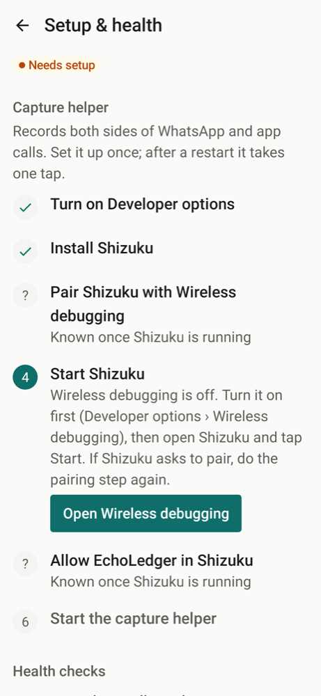
- Trash at 200 % in Urdu, dark: 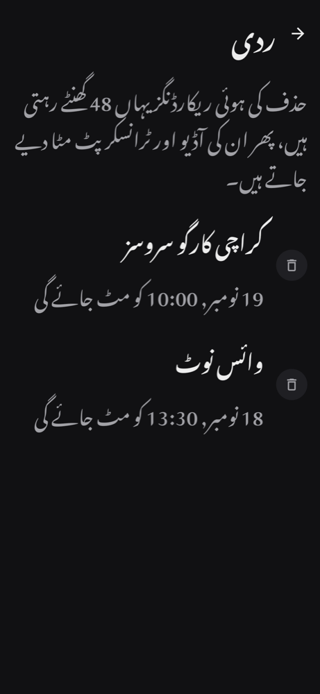
