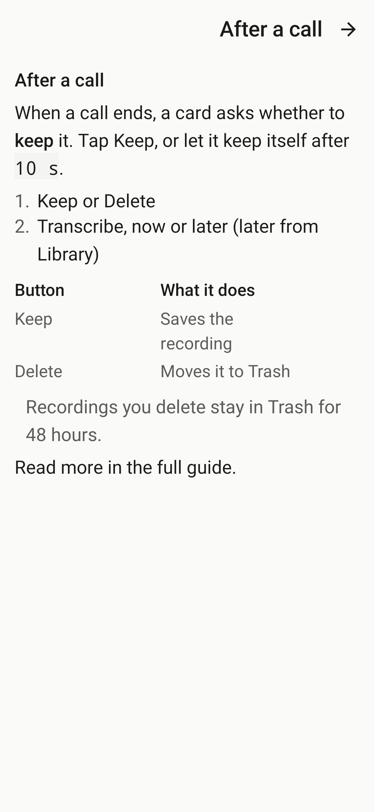
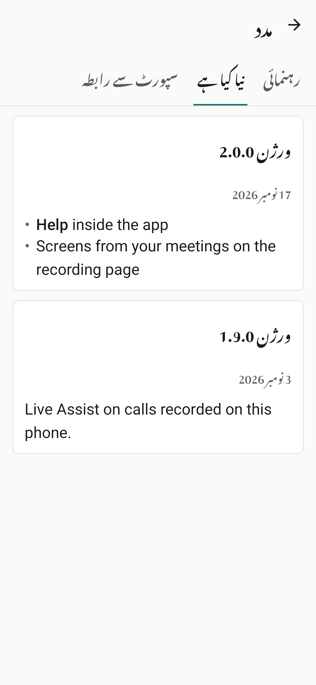
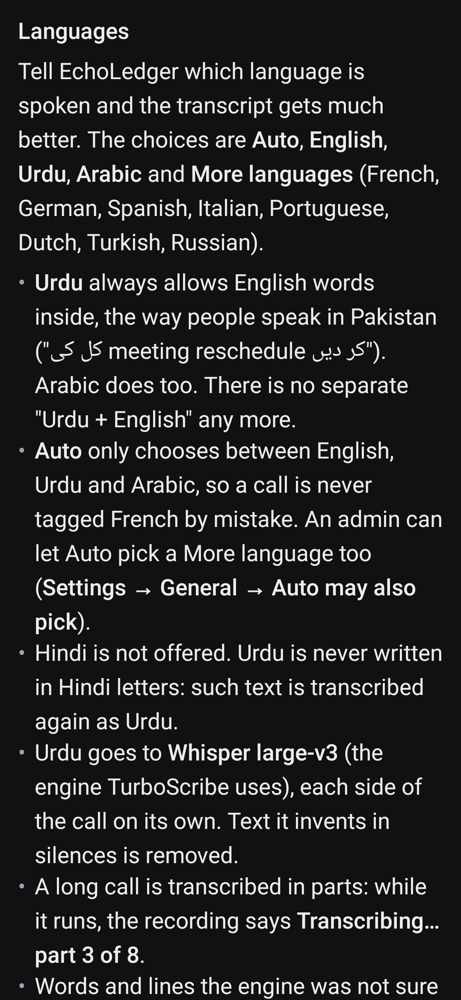
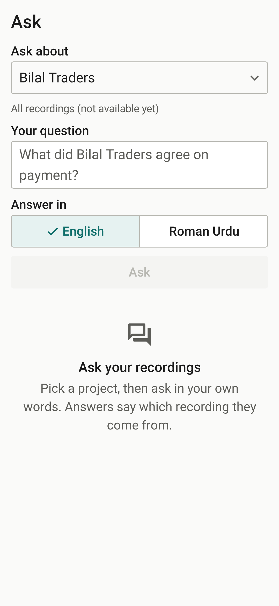
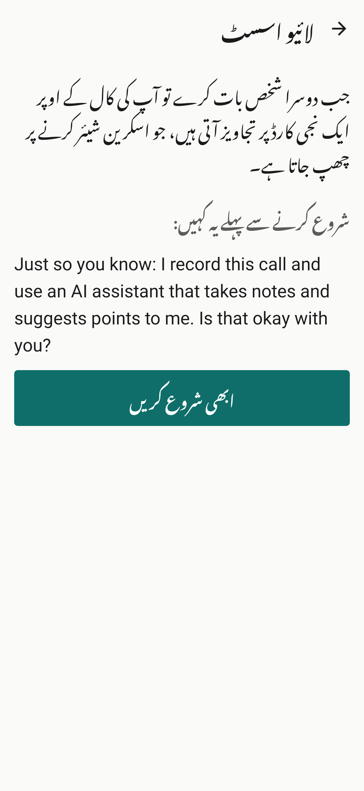
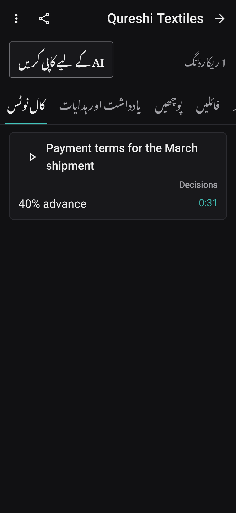
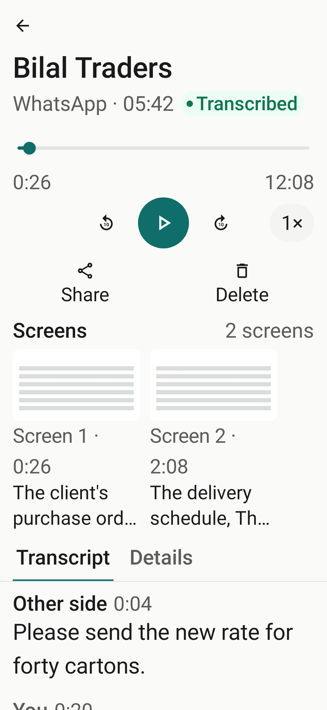
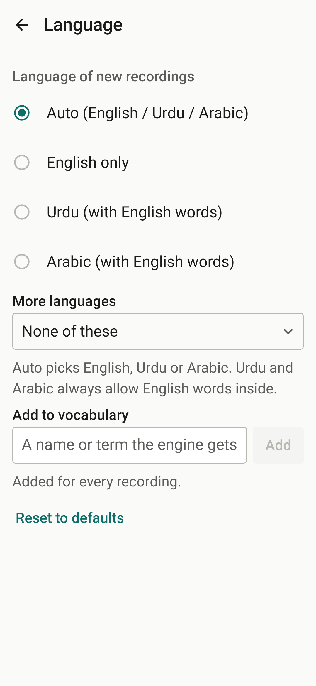

# Phone v2 final pass (2026-11-17)

Every v2 screen on the phone with all v2 flags on, at 130 % and 200 % text, light and dark, English and Urdu, at the
S25's size (411 × 891 dp). The Day 5 screens (`LargeTextTest`, also at 100 %) plus the screens added since
(`LargeTextScreensTest`): Help (guides, a guide, What's new, Contact support), Live Assist's start (can start, needs a
recording, running), Ask before a question, a recording's screens, the screen viewer, Settings from the avatar, every
v2 Settings page (Calls & meetings, Language, Custom words, Transcription key, App lock on and unavailable, Privacy &
data, Storage, Notifications) and a project's four tabs (Recordings, Memory & instructions, Files, Call notes).
37 screens (with the guide's section 12, Languages), 344 variants. Both tests use `BugBash`. To get the pictures and a contact sheet per screen, run from
`mobile/` with an `app/build/bugbash` folder present:

```
mkdir -p app/build/bugbash && bash ./gradlew :app:testFullDebugUnitTest --tests 'com.echoledger.mobile.ui.v2.LargeText*'
```

**How:** every run fails if a control is under 48 dp to touch at 200 % (dead or tiny taps); all 37 pass. I looked at
every contact sheet, light and dark, for text cut or broken, wrong direction or face in Urdu, and anything that reads
as a template. The template-look checks of Day 5 stay at 0: no gradients, purple, emoji, coloured start borders,
exclamation marks or placeholder copy in the v2 code and words, and no looping animation but the recording dot.

## Findings

| Id | Sev | Where | What | Status |
|---|---|---|---|---|
| P-091 | S2 | Help › a guide, What's new (Urdu) | English guides took the Urdu font's Latin letters and the screen's direction: list numbers at the end ("Keep or Delete .1"), table columns reversed. Now by the first strong letter, per block, per list item and by a table's header row | Fixed |
| P-092 | S3 | Ask | The example question was cut after one line | Fixed |
| P-093 | S3 | Live Assist start (Urdu) | The sentence to say used the Urdu font's Latin letters | Fixed |
| P-094 | S3 | Project › Call notes (Urdu) | A note's own heading used the Urdu font's Latin letters | Fixed |
| P-095 | S3 | Recording › Screens | At 200 %, a screen's label lost its time | Fixed |
| P-096 | S3 | Settings › Language | "Add to vocabulary" said twice | Fixed |
| P-097 | S4 | Messages | Two messages use a dash where the rest use a colon (phone core's words) | Logged |
| P-098 | S4 | Help (debug fixture) | Guide excerpts showed Markdown marks (the server's are plain) | Fixed |
| P-099 | S3 | Project page parity (test) | Under load the walk pressed Paste instructions before the Files tab had loaded | Fixed |

No S0 or S1; the one S2 is fixed. Still open from Day 5: P-085, P-086 (S3) and P-088 (S4).

## After the fixes

- P-091, an English guide on the Urdu screens: 
- P-091, What's new on the Urdu screens: 
- P-091, the guide's section 12 (an English list quoting Urdu), left to right on every screen:
  English light , Urdu light ,
  English dark , Urdu dark 
- P-092, the whole example question: 
- P-093, the sentence to say: 
- P-094, a call note's heading: 
- P-095, a screen's label at 200 %: 
- P-096, Language: 
